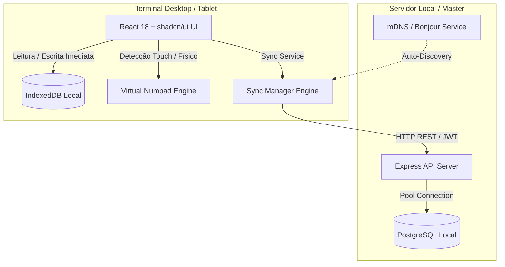

# 🛒 LocalTill POS - Sistema de Ponto de Venda Offline-First

[](https://www.typescriptlang.org/)
[](https://react.dev/)
[](https://www.electronjs.org/)
[](https://www.postgresql.org/)
[](https://tailwindcss.com/)
[](LICENSE)

> Sistema de Ponto de Venda (PDV) moderno, resiliente e de missão crítica, projetado com arquitetura **Offline-First**. Funciona de maneira ininterrupta em balcões de varejo mesmo com instabilidades severas de internet ou rede local.

---

## 📐 Visão Arquitetural

O LocalTill adota um modelo híbrido para garantir disponibilidade máxima:



### Principais Pilares da Engenharia:
1. **Zero Downtime Operacional:** Vendas são salvas imediatamente no IndexedDB. Se a rede cair, o caixa continua operando sem bloqueios ou telas de erro.
2. **Acessibilidade & Ergonomia Touch:** Interface inteligente que detecta dispositivos touch ou permite alternância manual, acionando teclado numérico embutido na tela com botões de 44px+ para idosos e operadores de balcão.
3. **Auditoria Rigorosa de Valores:** Suporte a múltiplas moedas (€, R$, $), controle de abertura, fechamento, suprimentos e sangrias com logs imutáveis e cálculo dinâmico de troco no cupom térmico.
4. **Descoberta Automática de Rede:** Protocolo mDNS / Bonjour que dispensa a configuração manual de IP em ambientes locais.

---

## 🛠️ Stack Tecnológica

| Camada | Tecnologia | Propósito |
| :--- | :--- | :--- |
| **Desktop Core** | Electron 40 | Execução nativa no Windows e macOS |
| **Frontend** | React 18, Vite 5, Tailwind CSS | Interface fluida, reativa e componentizada |
| **Componentes UI** | shadcn/ui, Radix UI primitives | Acessibilidade WAI-ARIA e design consistente |
| **Armazenamento Local** | IndexedDB | Cache e armazenamento offline de catálogo e vendas pendentes |
| **Backend API** | Node.js, Express, TypeScript | API REST modular para sincronização e gestão |
| **Banco de Dados** | PostgreSQL | Persistência relacional transacional com constraints rígidas |

---

## 🚀 Como Executar Localmente

### Pré-requisitos
- Node.js 20+
- PostgreSQL rodando localmente

### 1. Clonar e Instalar Dependências
```bash
git clone git@github.com:jhonatanecardoficial/localtill-pos.git
cd localtill-pos

# Instalar dependências da interface e do desktop
npm install

# Instalar dependências do servidor local
cd server
npm install
cd ..
```

### 2. Configurar Variáveis de Ambiente
Crie um arquivo `.env` dentro da pasta `server/` (veja `server/.env.example`):
```env
PORT=3000
DB_HOST=localhost
DB_PORT=5432
DB_USER=postgres
DB_PASSWORD=postgres
DB_NAME=pdv_local
JWT_SECRET=sua-chave-secreta-de-producao
```

### 3. Inicializar o Banco de Dados
```bash
cd server
npm run db:setup
cd ..
```

### 4. Executar em Desenvolvimento
```bash
# Executa servidor backend e interface web simultaneamente
npm run dev
```

Para executar empacotado no Electron:
```bash
npm run electron:dev
```

---

## 📦 Build para Produção

- **Windows:** `npm run electron:build:win` (Gera executável e ZIP portável em `release/`)
- **macOS:** `npm run electron:build:mac` (Gera `.app` e ZIP em `release/`)

---

## 📄 Licença e Propriedade Intelectual

Este projeto é **proprietário** e protegido pelas leis de direitos autorais. Todo o código é disponibilizado publicamente exclusivamente para fins de **demonstração técnica, portfólio profissional e avaliação de arquitetura de software**.

É estritamente proibido o uso comercial, pessoal, reprodução ou distribuição sem autorização prévia por escrito.

- **Autor:** Jhonatan Ecard
- **Contato:** [jhonatanecard@gmail.com](mailto:jhonatanecard@gmail.com)
- **GitHub:** [@jhonatanecardoficial](https://github.com/jhonatanecardoficial)
- Consulte o arquivo [LICENSE](LICENSE) para detalhes completos.
