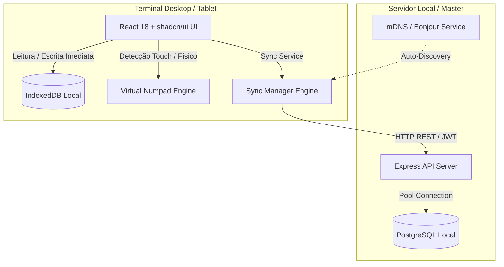

# Plano Mestre de Migração e Preparação para Portfólio: PDV LocalTill

> **Objetivo:** Criar um repositório novo, público, limpo e profissional no GitHub para exibição em portfólio de Desenvolvedor Sênior / Arquiteto de Software, mantendo o repositório original (`local-till`) 100% intacto.

---

## 📌 Contexto da Aplicação (Para o Novo Chat / Agente)

Este projeto é um **Sistema de Ponto de Venda (PDV) Híbrido, Offline-First e Multi-Plataforma**, projetado para rodar em computadores de varejo com ou sem internet:

- **Frontend:** React 18, Vite 5, TypeScript, Tailwind CSS, shadcn/ui, Radix UI.
- **Banco Offline Local:** IndexedDB com sincronização automática e manual.
- **Backend Local:** Node.js, Express, PostgreSQL nativo (pg pool), JWT, Bcrypt, Helmet, CORS.
- **Descoberta de Rede:** mDNS / Bonjour (`bonjour-service`) para descoberta zero-config de terminais na rede local.
- **Desktop Wrapper:** Electron 40 com empacotamento multi-plataforma (`electron-builder` e `electron-packager`).
- **Diferenciais Técnicos:**
  - Modo Touch sob medida para telas touch e operadores idosos (teclado numérico na tela, alvos de toque de 44px+).
  - Suporte a múltiplas moedas (Euro €, Real R$, Dólar $).
  - Auditoria completa de caixa: Abertura, Fechamento, Suprimentos (adicionar troco) e Sangrias (retirar troco) com histórico auditável.
  - Comprovante de venda não fiscal com cálculo dinâmico de valor recebido e troco devolvido formatado para impressoras térmicas.

---

## 🚀 Fase 1: Criação do Novo Repositório sem o Histórico Pesado (500 MB)

> [!IMPORTANT]
> O repositório atual possui ~500 MB de binários commitados no passado (`.cache/winCodeSign`). Não faça um `git push` do histórico antigo completo para o novo repositório, pois ele continuará pesado. Faça uma clonagem limpa com histórico zerado.

### Passo 1.1: Criar o Repositório no GitHub
1. Acesse o GitHub e crie um novo repositório público: `localtill-pos` (ou `nexus-pos`).
2. **Não** marque a opção de adicionar README, .gitignore ou License (deixe-o totalmente vazio).

### Passo 1.2: Clonar os Arquivos em uma Nova Pasta
Abra o terminal (PowerShell ou Bash) fora da pasta atual:

```bash
# 1. Crie uma pasta nova para o projeto de portfólio
mkdir localtill-portfolio
cd localtill-portfolio

# 2. Copie todo o código-fonte do projeto atual (exceto node_modules, release e .git)
# No Windows PowerShell:
robocopy "D:\caminho\projeto-original\local-till" . /E /XD node_modules release .git .cache dist dist-electron test-results playwright-report

# 3. Inicialize um novo repositório git limpo
git init
git branch -M main
```

---

## 🧹 Fase 2: Sanitização e White-Labeling (Desvincular Marca do Cliente)

### Passo 2.1: Limpeza de Arquivos Temporários
Remova arquivos de backup e rascunhos que não devem ir para o repositório público:

```bash
# Remover backups e caches
rm -f src/App.tsx.bak
rm -rf .cache
```

### Passo 2.2: Atualizar `.gitignore`
Edite o arquivo `.gitignore` para garantir que arquivos de cache e binários nunca sejam rastreados:

```gitignore
# Logs
logs
*.log
npm-debug.log*
yarn-debug.log*
yarn-error.log*

# Dependencies
node_modules/
dist/
dist-electron/
dist-ssr/

# Builds & Caches
release/
.cache/
*.bak
*.local

# Environment variables
.env
.env.*
! .env.example

# OS and Editor
.DS_Store
Thumbs.db
.vscode/*
!.vscode/extensions.json
.idea/

# Testing
playwright-report/
test-results/
```

### Passo 2.3: Atualizar `package.json`
Abra o `package.json` da raiz e altere os campos de metadados:

```json
{
  "name": "localtill-pos",
  "private": true,
  "description": "LocalTill - Sistema de Ponto de Venda (PDV) Offline-First Desktop e Web",
  "author": "Seu Nome <seu-email@dominio.com>",
  "version": "1.0.0",
  "main": "dist-electron/main.js"
}
```

No campo `"build"` do `package.json`, altere:
```json
  "build": {
    "appId": "com.localtill.pos",
    "productName": "LocalTill POS",
    "directories": {
      "output": "release"
    }
  }
```

### Passo 2.4: Organizar a Documentação Interna
Mova os relatórios e análises técnicas da raiz para uma pasta `docs/`:

```bash
mkdir -p docs/architecture
mv ANALISE_COMPLETA_PDV_GERENCIAL.md docs/architecture/
mv ANALISE_REVISADA_CORRIGIDA_PDV_2.md docs/architecture/
mv RELATORIO_SEGURANCA_ARQUITETURA_2025-12-15.md docs/architecture/
mv PLANO_CONFIGURACOES.md docs/architecture/
mv touch-pos-accessibility.md docs/architecture/
rm -f COMO_ATUALIZAR_EDGE_FUNCTION.md COMO_RODAR.md
```

---

## 📄 Fase 3: Criação do README.md Profissional (Nível Sênior/Arquiteto)

Substitua o `README.md` da raiz pelo seguinte conteúdo estruturado:

```markdown
# 🛒 LocalTill POS - Sistema de Ponto de Venda Offline-First

[](https://www.typescriptlang.org/)
[](https://react.dev/)
[](https://www.electronjs.org/)
[](https://www.postgresql.org/)
[](https://tailwindcss.com/)
[](LICENSE)

> Sistema de Ponto de Venda (PDV) moderno, resiliente e de missão crítica, projetado com arquitetura **Offline-First**. Funciona de maneira ininterrupta em balcões de varejo mesmo com instabilidades severas de internet ou rede local.

---

## 📐 Visão Arquitetural

O LocalTill adota um modelo híbrido para garantir disponibilidade máxima:



### Principais Pilares da Engenharia:
1. **Zero Downtime Operacional:** Vendas são salvas imediatamente no IndexedDB. Se a rede cair, o caixa continua operando sem bloqueios ou telas de erro.
2. **Acessibilidade & Ergonomia Touch:** Interface inteligente que detecta dispositivos touch ou permite alternância manual, acionando teclado numérico embutido na tela com botões de 44px+ para idosos e operadores de balcão.
3. **Auditoria Rigorosa de Valores:** Suporte a múltiplas moedas (€, R$, $), controle de abertura, fechamento, suprimentos e sangrias com logs imutáveis e cálculo dinâmico de troco no cupom térmico.
4. **Descoberta Automática de Rede:** Protocolo mDNS / Bonjour que dispensa a configuração manual de IP em ambientes locais.

---

## 🛠️ Stack Tecnológica

| Camada | Tecnologia | Propósito |
| :--- | :--- | :--- |
| **Desktop Core** | Electron 40 | Execução nativa no Windows e macOS |
| **Frontend** | React 18, Vite 5, Tailwind CSS | Interface fluida, reativa e componentizada |
| **Componentes UI** | shadcn/ui, Radix UI primitives | Acessibilidade WAI-ARIA e design consistente |
| **Armazenamento Local** | IndexedDB | Cache e armazenamento offline de catálogo e vendas pendentes |
| **Backend API** | Node.js, Express, TypeScript | API REST modular para sincronização e gestão |
| **Banco de Dados** | PostgreSQL | Persistência relacional transacional com constraints rígidas |

---

## 🚀 Como Executar Localmente

### Pré-requisitos
- Node.js 20+
- PostgreSQL rodando localmente

### 1. Clonar e Instalar Dependências
```bash
git clone https://github.com/seu-usuario/localtill-pos.git
cd localtill-pos

# Instalar dependências da interface e do desktop
npm install

# Instalar dependências do servidor local
cd server
npm install
cd ..
```

### 2. Configurar Variáveis de Ambiente
Crie um arquivo `.env` dentro da pasta `server/`:
```env
PORT=3000
DB_HOST=localhost
DB_PORT=5432
DB_USER=postgres
DB_PASSWORD=postgres
DB_NAME=pdv_db
JWT_SECRET=sua-chave-secreta-de-producao
```

### 3. Inicializar o Banco de Dados
```bash
cd server
npm run db:setup
cd ..
```

### 4. Executar em Desenvolvimento
```bash
# Executa servidor backend e interface web simultaneamente
npm run dev
```

Para executar empacotado no Electron:
```bash
npm run electron:dev
```

---

## 📦 Build para Produção

- **Windows:** `npm run electron:build:win` (Gera executável e ZIP portável em `release/`)
- **macOS:** `npm run electron:build:mac` (Gera `.app` e ZIP em `release/`)

---

## 📄 Licença

Distribuído sob a licença MIT. Veja `LICENSE` para mais informações.
```

---

## 🧪 Fase 4: Adicionar Testes Automatizados (Vitest)

Para demonstrar maturidade aos avaliadores, crie testes unitários para a regra financeira de troco e caixa:

### Passo 4.1: Instalar Vitest
```bash
npm install -D vitest @testing-library/react @testing-library/jest-dom
```

### Passo 4.2: Criar Arquivo de Teste `src/lib/__tests__/cashCalculation.test.ts`
```typescript
import { describe, it, expect } from 'vitest';

describe('Regras de Negócio: Cálculo de Troco e Movimentação de Caixa', () => {
  it('deve calcular o troco correto quando o valor pago for maior que o total da venda', () => {
    const totalVenda = 15.50;
    const valorPago = 20.00;
    const troco = Math.max(0, valorPago - totalVenda);

    expect(troco).toBeCloseTo(4.50);
  });

  it('deve retornar zero de troco quando o valor pago for exato', () => {
    const totalVenda = 50.00;
    const valorPago = 50.00;
    const troco = Math.max(0, valorPago - totalVenda);

    expect(troco).toBe(0);
  });

  it('deve somar corretamente o suprimento ao saldo atual do caixa', () => {
    const saldoInicial = 100.00;
    const suprimento = 50.00;
    const novoSaldo = saldoInicial + suprimento;

    expect(novoSaldo).toBe(150.00);
  });

  it('deve impedir sangria com valor superior ao saldo disponível', () => {
    const saldoDisponivel = 80.00;
    const sangriaTentada = 100.00;
    const sangriaPermitida = sangriaTentada <= saldoDisponivel;

    expect(sangriaPermitida).toBe(false);
  });
});
```

### Passo 4.3: Adicionar Script no `package.json`
```json
"test:unit": "vitest run"
```

---

## 🚀 Fase 5: Commit Inicial e Publicação no GitHub

Execute na pasta do novo projeto:

```bash
# 1. Configurar o remote do novo repositório
git remote add origin https://github.com/seu-usuario/localtill-pos.git

# 2. Adicionar arquivos sanitizados
git add .

# 3. Commit semântico profissional
git commit -m "feat: initial commit of LocalTill POS - offline-first retail desktop & web application"

# 4. Enviar para a branch principal
git push -u origin main
```
